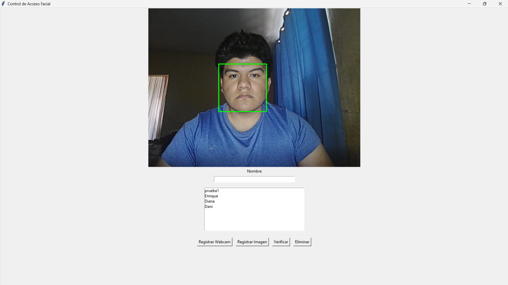
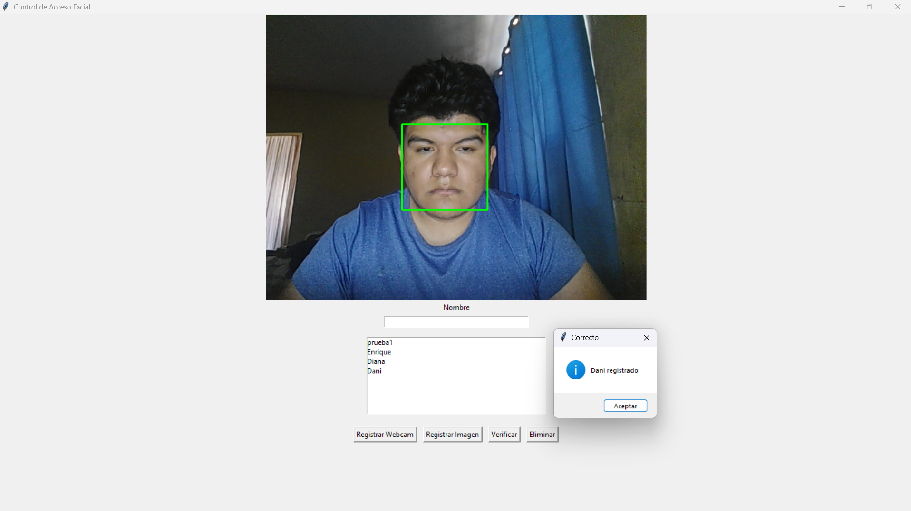
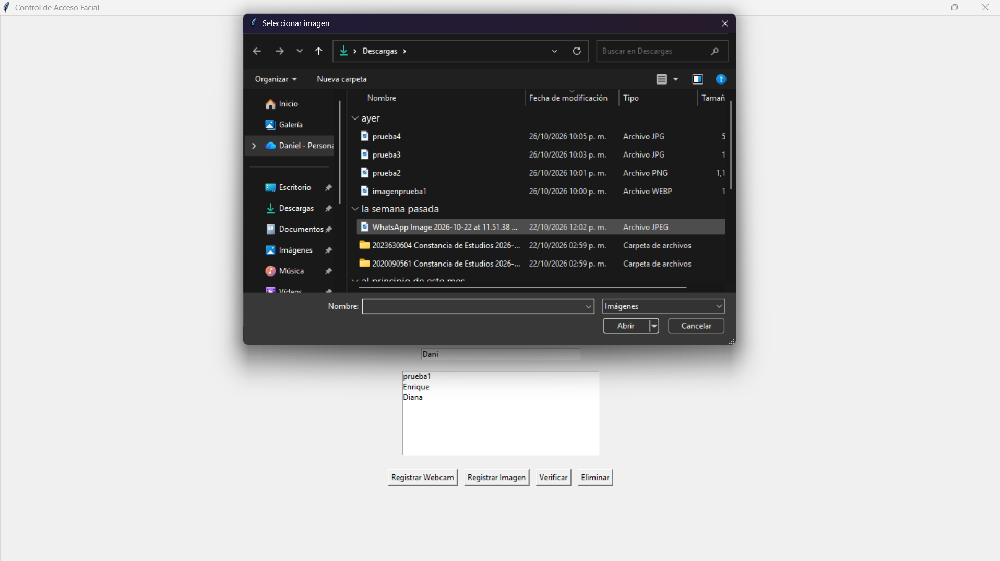
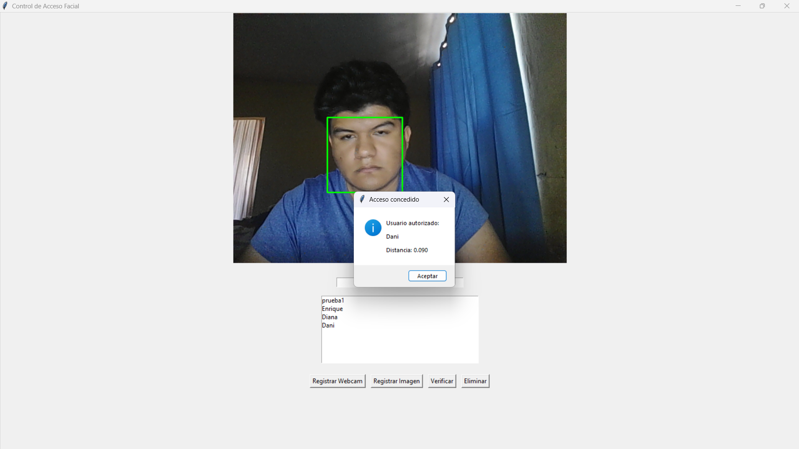
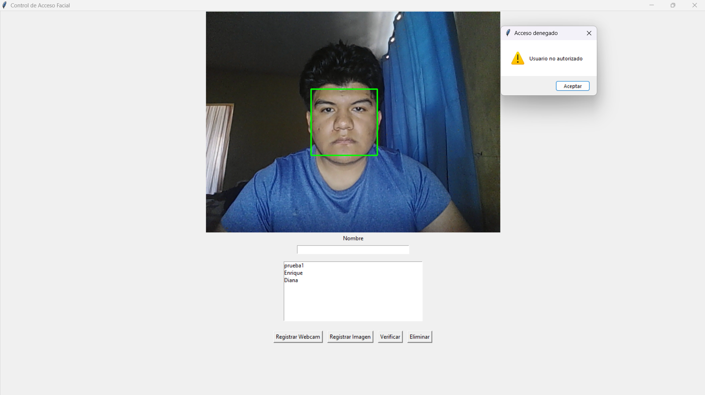

# Control de Acceso Facial

Sistema de reconocimiento facial desarrollado en Python que permite registrar usuarios autorizados y verificar su identidad en tiempo real mediante una cámara web o imágenes seleccionadas desde el explorador de archivos.

El proyecto utiliza técnicas de visión por computadora y reconocimiento facial para generar y almacenar encodings faciales, permitiendo autenticar usuarios de forma rápida y sencilla.

---

## Características

✅ Detección facial en tiempo real.

✅ Registro de usuarios mediante webcam.

✅ Registro de usuarios mediante imágenes locales.

✅ Almacenamiento persistente de usuarios registrados.

✅ Verificación de identidad mediante reconocimiento facial.

✅ Gestión de usuarios:
- Registrar usuarios.
- Eliminar usuarios.
- Visualizar usuarios autorizados.

✅ Interfaz gráfica desarrollada con Tkinter.

✅ Optimización de rendimiento mediante reducción de resolución para detección.

---

## Tecnologías utilizadas

- Python
- OpenCV
- Face Recognition
- dlib
- Tkinter
- Pillow
- NumPy
- Pickle

---

## Funcionamiento

### Registro desde Webcam

1. Escribe el nombre del usuario.
2. Sitúate frente a la cámara.
3. Pulsa **Registrar Webcam**.
4. El sistema detectará el rostro y almacenará el nombre junto con su encoding facial.

### Registro desde Imagen

1. Escribe el nombre del usuario.
2. Pulsa **Registrar Imagen**.
3. Selecciona una fotografía desde el explorador de archivos.
4. El sistema detectará el rostro y almacenará el encoding facial correspondiente.

### Verificación

1. Sitúate frente a la cámara.
2. Pulsa **Verificar**.
3. El sistema comparará el rostro detectado con los usuarios registrados.
4. Si encuentra coincidencia, se mostrará el nombre del usuario autorizado.
5. En caso contrario, el acceso será denegado.

---

## Instalación

### Clonar repositorio

```bash
git clone https://github.com/DanDr007/Control-Acceso-Facial.git
```

Entrar al directorio:

```bash
cd Control-Acceso-Facial
```

### Crear un entorno virtual

```bash
python -m venv venv
```

### Activar entorno virtual

Windows:

```bash
venv\Scripts\activate
```

Linux / MacOS:

```bash
source venv/bin/activate
```

### Instalar dependencias

```bash
pip install opencv-python
pip install face-recognition
pip install Pillow
pip install numpy
```

O utilizando:

```bash
pip install -r requirements.txt
```

---

## Estructura del Proyecto

```text
Control-Acceso-Facial/
│
├── main.py
├── usuarios.pkl
├── requirements.txt
├── README.md
│
└── capturas/
    ├── captura-principal.png
    ├── captura-registro-webcam.png
    ├── captura-registro-imagen.png
    ├── captura-autorizado.png
    └── captura-no-autorizado.png
```

---

## Capturas de Pantalla

### Interfaz Principal




---

### Registro mediante Webcam



---

### Registro mediante Imagen



---

### Usuario Autorizado



---

### Usuario No Autorizado



---

## Resultados de las Pruebas

Se realizaron pruebas con:

- 5 personas registradas.
- 10 verificaciones por persona.
- 50 verificaciones en total.

Condiciones:

- Usuario mirando directamente a la cámara.
- Iluminación adecuada.
- Rostro completamente visible.

Resultados obtenidos:

- 50 aciertos de 50 intentos.
- 100% de precisión bajo condiciones controladas.
- Sin falsos negativos durante las pruebas realizadas.

---

## Limitaciones

El sistema puede reducir su precisión en situaciones como:

- Iluminación insuficiente.
- Rostro parcialmente cubierto.
- Uso de mascarillas.
- Cambios extremos de ángulo.
- Fotografía de baja calidad.
- Sombras pronunciadas sobre el rostro.

---

## Mejoras Futuras

- Base de datos SQLite.
- Historial de accesos.
- Registro automático de fecha y hora.
- Sistema de roles y permisos.
- Exportación de registros.
- Detección de múltiples usuarios simultáneos.
- Integración con sistemas de control de acceso físicos.
- Despliegue como aplicación ejecutable.

---

## Autor

**Daniel Díaz**

Estudiante de Ingeniería en Sistemas Computacionales.

Proyecto desarrollado con fines académicos y de aprendizaje en visión por computadora y reconocimiento facial utilizando Python.

---

## Licencia

Este proyecto se distribuye únicamente con fines educativos y de investigación.